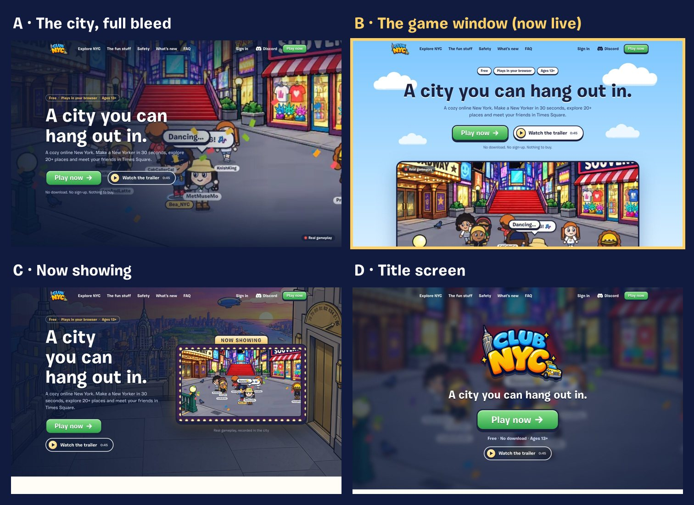

# The Club NYC landing page

The page at `/` (source: `app/index.html`, `app/src/landing/`). The game is at `/play`. Its one job is to get people
to press **Play now**; everything else (what it is, safety, Discord, FAQ) supports that.

## How it works

- **The hero** (option A, see [Design options](#design-options-the-lab)): a silent 14-second loop of real gameplay
  fills it, edge to edge, dark on the left where the words are. The header is white over it until you scroll.
  - The words: **"Waddle on over to New York."** and "Remember waddling around, meeting strangers, playing
    mini-games, and discovering secret rooms? Imagine all that nostalgia, but in NYC." They hint at Club Penguin
    without naming it (see [../launch/legal-callouts.md](../launch/legal-callouts.md)). No chip above the headline.
  - The headline, the description and **Play now** all start on the same pixel (the headline and description are
    nudged by their first letters' side bearings, W 0.027em and R 0.077em, so the ink lines up). Both buttons have
    the same 22px corners.
  - Only landmarks anyone recognizes (Liberty Island, Times Square, Brooklyn Bridge, Central Park, Grand Central,
    the Empire State Building, Rockefeller Center), filmed at 2560 px. High-density laptops and wide monitors get the 1440p loop, other
    big screens the 1080p one, the rest 720p (`<source media>`). It starts once the page has loaded and pauses while
    it's off screen.
  - A small pause button (bottom right; top right on phones), because the loop runs longer than 5 seconds
    (WCAG 2.2.2). A pause sticks.
  - People who prefer less motion, or whose browser asks to save data, see the still poster instead.
- **At a glance**, four tiles over the hero's bottom edge: the Dance Jam (a live countdown on the game's own clock,
  `app/src/data/jam.ts`), chat bubbles popping in, the map ("20+ places"), and Free.
- **Explore NYC** and **The fun stuff** are bento grids of real gameplay: each tile's clip loads as you scroll near it
  and plays only while you can see it (`video[data-clip]`, clips from `npm --prefix video run clips`).
- **The trailer** opens in a dialog, sound on, with nothing under it: 43 seconds of real gameplay, a day in the city
  told by a group chat, to an acoustic version of the game's own song. How it's made: [launch-video.md](launch-video.md).
- **Play now** (`/play?start=guest`) skips the old front door and opens the New Yorker creator straight away. It
  appears in the hero, the sticky header, after the features, at the end and in the footer. The header has no
  separate Sign in; the footer keeps a small **Sign in** link (`/play`, the front door with Google, X and Discord),
  because Play now always starts a new guest and a returning player on a new computer needs a way back.
- **Returning players** (a New Yorker saved in this browser) see "Welcome back, {name}!" and a **Continue playing**
  button.
- **Phones get the full page**, but every Play button becomes **Send to my computer** (the phone's share sheet,
  copy link, or email). A small "try it on this device anyway" link is there too. Club NYC plays on computers, and a
  dead end would lose the visitor.
- **Invite links** (`/join/<name>`) skip the landing page and open the game next to the friend.
- **Live player count:** shown only once 20+ people are online. Small numbers read as "empty" (see the research
  below).
- **Funnel:** the moderator dashboard has a *Landing page* card: visits, Play clicks, New Yorkers made from those
  visits, trailer plays, phone visitors, links sent to a computer, and Discord clicks. It's anonymous, per browser
  tab.
- **Placeholders the server fills:** `CONTACT_EMAIL`, `COMPANY_NAME`, `GOVERNING_STATE`, `MAILING_ADDRESS` and
  `DISCORD_INVITE_URL` (see [../deploy-railway.md](../deploy-railway.md#5-set-the-variables)).
- **Safety** is the five rules, how to report, and how the city stays friendly. The game is for 13 and up and the page
  speaks to players, not parents (the policies are linked from the footer, and from the sign-up's age check).
- **The city so far** (after The fun stuff): real totals on a departures board whose digits flip into place when
  you scroll to it (`app/src/landing/stats.ts`, from `GET /api/stats`, re-counted once a minute): New Yorkers who've
  moved in ("You'd be #1,285"), pizzas made at Slice Factory with this week's top slicer, and who's out right now
  (only at 10+ online). Small numbers get honest copy ("NEW", "HIRING", "Could be you") and the section stays hidden
  if the numbers can't be fetched. Pizzas are counted from each accepted shift's score (`game_runs.score`, from
  19 October 2026).
- **The FAQ** is one list, most-asked first.
- **The last call** says "The Big Apple is waiting."
- **Search and sharing:**
  - Title, description, Open Graph and X tags, plus VideoGame and WebSite structured data.
  - A canonical URL, `robots.txt` and `sitemap.xml`.
  - The game page says `noindex`, so search engines index the landing page instead.

## Speed (measured 18 October 2026, production build)

- **Landing page:** largest paint well under a second locally, no layout shift.
- **Landing page weight:** a few KB of JavaScript and CSS (compressed). Everything below the first screen loads as
  you scroll to it.
- **The hero's video:**
  - The poster (130 KB WebP) is preloaded, so the first screen is complete straight away.
  - The loop (WebM, MP4 for Safari: 2.3 MB at 720p, 4.0 MB at 1080p, 5.8 MB at 1440p) only starts downloading
    after the page has loaded.
- **The tiles' clips:** 15 loops, 4.6 MB in all, each fetched only as its tile comes near and paused when it leaves.
  - The 18 MB trailer downloads only when someone presses play. The server answers range requests, so it starts
    playing straight away and can be skipped through.
- **Play now to the creator:** about 0.4 s locally.
- **A new player's whole download into Times Square:** about 1.5 MB, down from 3.5 MB:
  - The server sends WebP versions of the art (`tools/webp.py`).
  - Pages go out compressed, and the fonts have brotli copies.

## Gameplay clips (and the avatar)

The tiles show real gameplay, so they show today's avatar. When the avatar art changes, re-film and re-cut everything
with the commands in [launch-video.md](launch-video.md#make-it-again), then `npm --prefix video run clips` for the
tiles. Clips have no text baked in; each tile's words are HTML.

## What the research said, and where the page follows it

| Advice | On the page | Source |
|---|---|---|
| One primary action, repeated: hero, mid-page, end, sticky header | Play now in 5 places; Discord stays a text link | NN/g [scrolling and attention](https://www.nngroup.com/articles/scrolling-and-attention/) (57% of viewing time above the fold); [sticky headers](https://www.nngroup.com/articles/sticky-headers/) |
| Short, plain copy converts better (5th–7th grade reading level beat professional-level copy, 11.1% vs 5.3%) | Hero under 25 words; plain words throughout | [Unbounce 2024 benchmark](https://unbounce.com/conversion-benchmark-report/) (vendor data, correlational) |
| Show real gameplay; clips beat GIFs; no marketing text in shots | Feature placeholders specify real gameplay; loops as MP4/WebM | [Steam trailers](https://partner.steamgames.com/doc/store/trailer), [assets](https://partner.steamgames.com/doc/store/assets/standard), [web.dev](https://web.dev/articles/replace-gifs-with-videos) |
| Don't fake social proof before launch; small counts can backfire | No testimonials; live count only at 20+ | [FTC 2024 rule](https://www.ftc.gov/news-events/news/press-releases/2024/08/federal-trade-commission-announces-final-rule-banning-fake-reviews-testimonials), [NN/g trust](https://www.nngroup.com/articles/trustworthy-design/) |
| Phones: show the full page, swap the button for "send to a computer" | Send to my computer → share sheet / copy / email | [Google mobile-first indexing](https://developers.google.com/search/docs/crawling-indexing/mobile/mobile-sites-mobile-first-indexing), [Web Share](https://developer.mozilla.org/en-US/docs/Web/API/Navigator/share) |
| Detect touch and pointer features, not user-agent strings | `pointer: coarse` + screen size, same as the game | [MDN](https://developer.mozilla.org/en-US/docs/Web/HTTP/Guides/Browser_detection_using_the_user_agent) |
| Returning players: keep the landing page, offer "Continue as {name}" | Welcome back + Continue playing; no redirect flash | [Railway's reasoning](https://station.railway.com/feedback/redirecting-non-new-users-9f4b7c8b) |
| Invite links skip the marketing page | `/join/<name>` opens the game | [Discord invites](https://discord.com/invite/minecraft) |
| LCP ≤ 2.5 s, CLS ≤ 0.1; hero image eager with `fetchpriority="high"`, the rest lazy | Hero poster preloaded, every image and the video sized, lazy below the fold |
| Video heroes: muted, inline, a poster, no autoplay for reduced motion, a pause control for anything over 5 s | The game window: all of these, plus the loop only loads after the page | [web.dev lazy-loading video](https://web.dev/articles/lazy-loading-video), [WCAG 2.2.2](https://www.w3.org/WAI/WCAG22/Understanding/pause-stop-hide.html) | [web.dev vitals](https://web.dev/articles/vitals), [LCP](https://web.dev/articles/optimize-lcp) |
| Short rules on the page, full rules a click away | Five rules + consequences; the full rules in the footer | [Club Penguin rules (2016)](https://web.archive.org/web/20160211031928/http://www.clubpenguin.com/club-penguin-rules), [ICO standard 4](https://ico.org.uk/for-organisations/uk-gdpr-guidance-and-resources/childrens-information/childrens-code-guidance-and-resources/age-appropriate-design-a-code-of-practice-for-online-services/code-standards/) |
| Say "filtered and moderated", never "100% safe"; "Recommended 13+", no ESRB icons | Safety section wording | [ESRB](https://www.esrb.org/ratings-guide/), [IARC](https://globalratings.com/faq/) |
| FAQ rich results are gone (since 7 May 2026): write the FAQ for people | No FAQPage markup | [Google](https://developers.google.com/search/updates) |
| Link Discord through your own redirect, never-expiring invite | `/discord` → `DISCORD_INVITE_URL` | [Discord invites](https://support.discord.com/hc/en-us/articles/208866998-Invites-101), [Check Point](https://research.checkpoint.com/2025/from-trust-to-threat-hijacked-discord-invites-used-for-multi-stage-malware-delivery/) |

## Design options (the lab)

Every option lives in `app/lab/`, a dev-only folder: the dev server serves it, the build leaves it out. Open
**`/lab/`** on the dev server (for example `bash tools/qa_stack.sh`, then http://localhost:5197/lab/) for the list.

| | Option | What it is | Verdict |
|---|---|---|---|
| **A** | **The city, full bleed** (hero, **live**) | The gameplay loop fills the hero, with the words over a dark fade | Chosen. Now with the 1080p loop, a white header, no chip and the buttons left-aligned with the words |
| B | The game window (hero) | A sunny sky, the headline, Play now and the trailer button, and the game playing in a window below | Live before A; bright and friendly |
| C | Now showing (hero) | Words on the left; the loop in a Broadway marquee billboard over the city at sunset | Charming, but a lot going on |
| D | Title screen (hero) | A blurred city, a big logo and a giant Play now, like the trailer's end card | The most focused on Play now, but you can barely see the game |
| E | Cinematic scroll (whole page) | One video plays behind the whole page and scrolling reshapes it: full screen → a game window with chat bubbles flying in → places streaming past sideways → the video inside the letters of HANG OUT, then through them → feature cards stacking → the Dance Jam with a live countdown → rules flying in → "Your city is waiting." | The most memorable. Heavier (a few MB of video), and the motion is the point, so it needs the still fallback it has for people who prefer less motion |
| F | Bento city (whole page) | Bright and calm: the city at a glance in rounded tiles, each one playing real gameplay, with a live Dance Jam countdown and chat that pops in | Its tiles now live on the real page, below hero A: at a glance, Explore NYC and The fun stuff |

- **Switching the live page** to another hero (B to D): copy its markup from `app/lab/hero.html` into
  `app/index.html` and its styles from `app/lab/hero.css` into `landing.css`.
- **The lab's own clips** (bigger, more of them) come from `npm --prefix video run clips -- --lab` into
  `app/lab/clips/` (git-ignored, about 19 MB).

## Ideas for later

- **Re-make the trailer and the loop** when the avatar art changes (one command each, see
  [launch-video.md](launch-video.md)).
- **A vertical (9:16) cut** of the trailer for TikTok, Reels and Shorts.
- **Founder note:** a short note in your own words. It's honest social proof before there are reviews.
- **Real Discord counts** from Discord's invite API (`with_counts`), once the server has members.
- **A changelog page** (`/updates`, with RSS) if updates need a home again. "What's new" left the landing page on
  18 October 2026; the Discord and the in-game newspaper carry news for now.
- **Prefetch the game** on hover of Play now. Don't prerender it: prerendering would run the game's sign-in and
  create guest accounts for people who only hovered.
- **Clips next to each step** in "Your first five minutes".
